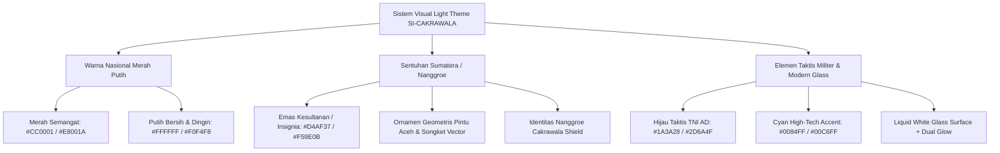
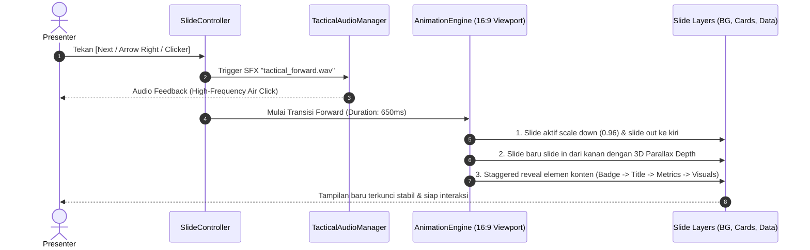
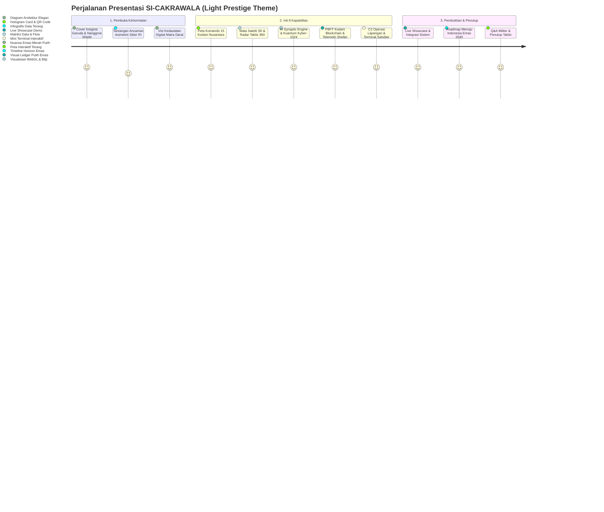

# 📋 DOKUMENTASI IMPLEMENTASI PLAN: WEB-BASED TACTICAL PRESENTATION (PPT SIBER)
### Karya: SI-CAKRAWALA | Nanggroe Cakrawala Shield — TNI AD
**Repositori Sumber:** `D:\flutter1\siber`  
**Live Site:** [https://nazarulqudritrkj.github.io/siber/](https://nazarulqudritrkj.github.io/siber/)  
**Proyek Presentasi:** `D:\flutter1\pptsiber`  
**Arah Estetika:** **Light Theme Ultra-Professional (Bukan Dark Mode)** — Nuansa Merah Putih Indonesia, Ornamen Nusantara/Sumatera (Nanggroe), Aksen Emas Komando & Hijau TNI AD, Liquid Glassmorphism, Rich Motion Transitions & Audio SFX.

---

## 1. Ringkasan Eksekutif & Paradigma Baru Desain

### 1.1 Urgensi & Visi
Sistem pertahanan siber **SI-CAKRAWALA (Nanggroe Cakrawala Shield — TNI AD)** merupakan inovasi strategis pertahanan kedaulatan digital Indonesia. Untuk menyampaikan pesan kepemimpinan militer, inovasi teknologi mutakhir, dan kebanggaan nasional secara bermartabat kepada juri, perwira tinggi, dan akademisi, **konsep gelap (dark mode / hacker cliché) DITINGGALKAN**. 

Sebagai gantinya, presentasi web ini mengadopsi gaya **Light Theme High-End Prestige UI/UX**, yang memadukan:
1. **Nuansa Nasional Merah-Putih & Kemegahan Emas Insignia**.
2. **Kearifan Lokal Ornamen Geometris Sumatera (Nanggroe / Pintu Aceh / Songket Taktis)** yang melambangkan benteng pertahanan maritim dan darat di gerbang barat Nusantara.
3. **Sentuhan Kemewahan Modern (Liquid Glassmorphism Terang)** dengan pantulan cahaya, blur dinamis, dan tipografi tajam.
4. **Rich Motion Design & Kinetic Transitions** untuk navigasi Next & Back (bukan sekadar slide kaku).
5. **Tactical Audio Soundscape** dengan efek suara futuristik yang halus saat navigasi maju dan mundur.

---

## 2. Desain UI/UX: Nuansa Terang, Merah Putih, & Aksen Budaya Sumatera



### 2.1 Palet Warna Resmi (Light Prestige Palette)

| Komponen Desain | Kode Hex / Nilai | Karakteristik Visual & Makna |
|:---|:---|:---|
| **Background Kanvas Utama** | `#F4F7FB` s/d `#FFFFFF` | Putih bersih bergradasi dingin ultra-modern, memberikan kesan lapang, prestisius, dan tidak melelahkan mata. |
| **Merah Indonesia (Primary)** | `#CC0001` & `#E8001A` | Lambang keberanian, kedaulatan, dan keaktifan komando siber nasional. |
| **Putih Suci (Surface)** | `#FFFFFF` (Opasitas 85-92%) | Panel liquid glassmorphism putih bersih dengan backdrop-filter blur 20px. |
| **Emas Insignia Sumatera** | `#D4AF37` & `#B8860B` | Representasi kemuliaan tradisi Nanggroe Sumatera dan lencana kepemimpinan TNI AD. |
| **Hijau Taktis Komando** | `#1A3A28` & `#2D6A4F` | Identitas korps infanteri & kesatuan pertahanan darat TNI AD. |
| **Cyber Accent Blue/Cyan** | `#0072FF` & `#00A3FF` | Indikator status data aktif, sinyal telemetri, dan konektivitas orbit satelit. |
| **Tipografi Utama** | `#0F172A` (Slate Dark) | Kontras teks tingkat tinggi (WCAG AAA compliant), tajam dan mudah dibaca dari kejauhan. |

### 2.2 Integrasi Ornamen Budaya Sumatera (Nanggroe Identity)
- **Watermark Siluet Pintu Aceh / Songket Taktis:** Ditempatkan sebagai *low-opacity vector background* (opasitas 3–5%) di sudut slide, menyimbolkan ketangguhan benteng pertahanan *Nanggroe* yang kokoh dan tak tertembus.
- **Header Insignia Crest:** Logo Garuda Siber yang dikelilingi ornamen cincin fraktal geometris keemasan berpadu merah marun.
- **Border Frame Emas & Merah:** Garis tepi kartu taktis (*cards*) menggunakan gradasi tipis emas-ke-merah dengan radius kurva lengkung modern (*rounded-2xl*).

---

## 3. Sistem Animasi Kaya Efek (Rich Kinetic Motion)

Untuk menghasilkan sensasi presentasi berkelas teknologi tinggi, navigasi antar-slide dan elemen konten tidak boleh kaku atau instan. Presentasi akan menerapkan **Multi-layered Staggered Kinetic Motion**:



### 3.1 Spesifikasi Animasi Next & Back (Bidirectional Flow)

1. **Arah Maju (Next Navigation):**
   - **Slide Out:** Slide lama bergerak ke kiri (-8% offset), menyusut lembut (*scale* 1.0 $\to$ 0.95), dan memudar (*opacity* 1.0 $\to$ 0.0) dengan kurva `Curves.easeInOutCubic`.
   - **Slide In:** Slide baru meluncur masuk dari kanan (+15% offset), membesar dari 0.95 ke 1.0, dengan bayangan kedalaman (*depth shadow*) warna merah-emas lembut.
2. **Arah Mundur (Back Navigation):**
   - **Slide Out:** Slide lama meluncur kembali ke kanan (+8% offset) dengan *pull-back effect*.
   - **Slide In:** Slide sebelumnya kembali dari kiri (-15% offset) dengan pembesaran lembut dan pemulihan posisi presisi.
3. **Staggered Layer Reveal (Animasi Isi Slide):**
   - **0ms – 150ms:** Latar belakang glass dan garis ornamen Sumatera memposisikan diri.
   - **150ms – 350ms:** Badge kategori militer dan Judul Utama meluncur turun (*slide down + fade*).
   - **300ms – 550ms:** Komponen kartu taktis, grafik, atau radar muncul berurutan (*interval delay 80ms antar kartu*).
   - **500ms – 750ms:** Angka telemetri dan status AI menyala berdenyut (*counter roll & glow highlight*).

---

## 4. Sistem Efek Suara (Tactical Audio Soundscape)

Presentasi dilengkapi dengan sistem suara taktis audio presisi rendah-latensi yang menyempurnakan pengalaman multisensori tanpa mengganggu suara pembicara:

### 4.1 Rincian Sound FX Engine

| Aksi Navigasi | Karakter Suara | Durasi | Tujuan Psikologis Audiens |
|:---|:---|:---:|:---|
| **Next Slide (Maju)** | *High-tech crisp pneumatic whoosh + affirmative sub-click* | ~180 ms | Menandakan langkah strategis komando bergerak maju ke babak berikutnya; tegas dan modern. |
| **Back Slide (Mundur)** | *Reverse resonant cue / harmonic tone down* | ~220 ms | Memberi tanda audio intuitif bahwa presenter sedang mereview atau kembali ke poin sebelumnya. |
| **Card / Blip Hover** | *Subtle microwave tick (3KHz, ultra-low volume)* | ~40 ms | Responsif terhadap kursor presenter saat menunjuk komponen penting. |
| **Terminal / Demo Exec** | *Mechanical cyber-type stroke* | ~60 ms | Realisme saat demonstrasi CLI Linux C2. |

### 4.2 Kontrol Suara & Aksesibilitas (HUD Audio Controls)
- **Master Sound Toggle:** Tersedia tombol taktis di pojok kanan atas HUD dengan ikon speaker dinamis + animasi bar equalizer 3-garis hijau neon/emas saat audio aktif.
- **Shortcut Mute:** Tombol keyboard `M` untuk mematikan/menyalakan suara seketika.
- **Implementasi Non-Blocking:** Menggunakan sintesis audio via Web Audio API browser atau buffer memory, sehingga tidak membebani network saat pergantian slide.

---

## 5. Struktur Konten & Storyboard 11 Slide Master (Nuansa Terang)



### Rincian 11 Slide Master:

| No | Nama Slide | Komposisi Visual (Light Theme) | Interaktivitas & Animasi Kunci |
|:---:|:---|:---|:---|
| **01** | **Hero Cover: SI-CAKRAWALA** | Latar belakang putih mutiara dengan bias radial merah-emas. Lambang Garuda Siber TNI AD di tengah dengan ornamen geometris Sumatera berputar perlahan. | Tombol "MULAI KOMANDO" dengan riak cahaya (*pulse ripple*), lencana status `OPTIMAL`, audio cue pembuka. |
| **02** | **Threat Horizon: Kedaulatan RI** | Kartu data putih kaca (*glass cards*) menampilkan visual serangan siber terhadap infrastruktur vital Indonesia. | Animasi counter angka anomali siber yang berputar naik (*numeric odometer rolling*). |
| **03** | **Konsep Nanggroe Shield** | Visual perisai pertahanan berlapis dengan aksen merah berani dan emas, menjabarkan filosofi pertahanan darat cerdas. | Diagram lapisan pertahanan yang mengembang (*staggered expansion*) saat slide aktif. |
| **04** | **Topologi 15 Kodam Nusantara** | Peta Indonesia berlatar terang dengan titik 15 Kodam (Iskandar Muda hingga Cenderawasih) berdenyut hijau-merah. | Klik pada node Kodam menampilkan pop-up latensi jaringan (<15ms) dan status PBFT ledger. |
| **05** | **Satelit 3D & Radar Siber 360°** | Kolom ganda: Mini visualisasi satelit orbit Nusantara berdampingan dengan radar taktis 360° hijau neon berlatar putih kaca. | Sapuan radar hidup (*realtime sweep animation*) dengan blip target yang dapat dikunci. |
| **06** | **AI Intelijen & Kriptografi Kuantum** | Kartu perbandingan grafis neural engine (akurasi 98.4%) dan diagram kunci enkripsi pasca-kuantum Kyber-1024. | Indikator kecepatan inferensi 3.8ms dengan progress bar kilat bergradasi cyan-emas. |
| **07** | **Blockchain Kodam & Telemetri** | Rantai blok terdistribusi berkilau emas dengan indikator sensor suhu, seismik, dan GPU shelter TNI AD. | Simulasi penambahan blok baru (*consensus block mined*) secara visual. |
| **08** | **Operasi Lapangan C2 & Konsol** | Antarmuka mobile satgas tempur dipadukan dengan jendela konsol Linux miniatur (`satsiber@cakrawala`). | Terminal fungsional: Presenter dapat mengetikkan `status` atau `deploy` langsung di slide. |
| **09** | **Live Showcase Web Demonstration** | Frame pratinjau interaktif terintegrasi dari link produksi [nazarulqudritrkj.github.io/siber/](https://nazarulqudritrkj.github.io/siber/). | Tombol alih layar penuh dan tautan navigasi langsung ke modul live. |
| **10** | **Roadmap Indonesia Emas 2045** | Garis waktu horizontal emas-merah: Tahap Konsolidasi (2026), Ekspansi Satelit (2035), Supremasi Penuh (2045). | Titik tonggak bersinar terang saat kursor melintas (*hover shimmer effect*). |
| **11** | **Kesimpulan Strategis & Q&A** | Kartu kehormatan penutup, QR Code pemicu akses website siber, data kontak Satuan Siber. | Tombol "ULANGI PRESENTASI" (kembali ke slide 1) dan tombol unduh ringkasan eksekutif. |

---

## 6. Arsitektur Teknis Implementasi Flutter Web (`pptsiber`)

### 6.1 Struktur Modul Proyek
```
d:\flutter1\pptsiber\
├── lib/
│   ├── main.dart                             # Inisialisasi tema Light Prestige & sound
│   ├── core/
│   │   ├── theme/
│   │   │   ├── ppt_colors.dart               # Merah Indonesia, Emas Nanggroe, Putih Kaca
│   │   │   ├── ppt_decorations.dart          # Glassmorphism, bayangan mewah, ornamen border
│   │   │   └── ppt_typography.dart           # Orbitron, Exo 2, Fira Code
│   │   ├── audio/
│   │   │   └── tactical_audio_player.dart    # Web Audio / SFX Next, Back, Click Engine
│   │   └── painters/
│   │       ├── sumatera_ornament_painter.dart# CustomPainter motif geometris Pintu Aceh/Nanggroe
│   │       ├── tactical_radar_painter.dart   # Porting radar 360 dari proyek siber
│   │       └── neural_network_painter.dart   # Porting visualisasi AI
│   ├── engine/
│   │   ├── slide_controller.dart             # State currentIndex, direction (Next/Prev), timer
│   │   ├── presentation_scaffold.dart        # 16:9 ratio keeper, watermark, background glow
│   │   ├── slide_transition_builder.dart    # 3D Depth Shift + Cubic Bezier transition
│   │   └── presenter_hud.dart                # Tombol Next/Back, Sound toggle, Slide counter
│   └── slides/
│       ├── slide_01_hero.dart
│       ├── slide_02_threat_landscape.dart
│       ├── slide_03_vision_concept.dart
│       ├── slide_04_kodam_topology.dart
│       ├── slide_05_satelit_radar.dart
│       ├── slide_06_ai_crypto.dart
│       ├── slide_07_blockchain_tele.dart
│       ├── slide_08_field_terminal.dart
│       ├── slide_09_live_showcase.dart
│       ├── slide_10_roadmap_2045.dart
│       └── slide_11_closing_qa.dart
```

### 6.2 Contoh Implementasi Transisi Berarah (Next vs Back Animation)

```dart
class SlideTransitionBuilder extends StatelessWidget {
  final Widget child;
  final SlideDirection direction; // Next atau Back
  final Animation<double> animation;

  const SlideTransitionBuilder({
    super.key,
    required this.child,
    required this.direction,
    required this.animation,
  });

  @override
  Widget build(BuildContext context) {
    final curvedAnimation = CurvedAnimation(
      parent: animation,
      curve: Curves.easeOutCubic,
    );

    // Jika maju: masuk dari kanan (offset x: +0.25 -> 0.0)
    // Jika mundur: masuk dari kiri (offset x: -0.25 -> 0.0)
    final double startOffset = direction == SlideDirection.next ? 0.25 : -0.25;

    return SlideTransition(
      position: Tween<Offset>(
        begin: Offset(startOffset, 0),
        end: Offset.zero,
      ).animate(curvedAnimation),
      child: FadeTransition(
        opacity: Tween<double>(begin: 0.0, end: 1.0).animate(curvedAnimation),
        child: ScaleTransition(
          scale: Tween<double>(begin: 0.96, end: 1.0).animate(curvedAnimation),
          child: child,
        ),
      ),
    );
  }
}
```

### 6.3 Contoh Implementasi SFX Engine Taktis (Web Audio Synthesizer)

```dart
class TacticalAudioService {
  static bool isMuted = false;

  static void playNextSound() {
    if (isMuted) return;
    // Memainkan nada taktikal frekuensi naik (whoosh + click)
    _playToneSequence([
      ToneData(frequency: 520, durationMs: 40, gain: 0.08),
      ToneData(frequency: 880, durationMs: 80, gain: 0.12),
    ]);
  }

  static void playBackSound() {
    if (isMuted) return;
    // Memainkan nada taktikal frekuensi turun (harmonic rewind)
    _playToneSequence([
      ToneData(frequency: 740, durationMs: 40, gain: 0.10),
      ToneData(frequency: 440, durationMs: 90, gain: 0.07),
    ]);
  }
}
```

---

## 7. Rencana Tahapan Eksekusi Diperbarui (Milestones)

```mermaid
gantt
    title Jadwal Implementasi Presentasi Web SI-CAKRAWALA
    dateFormat  YYYY-MM-DD
    section Fase 1: Desain & Audio
    Setup Pubspec, Fonts & Asset Ornamen Sumatera :2026-11-13, 2d
    Pembuatan Sistem Audio SFX (Next/Back)        :2026-11-15, 1d
    Design System: Light Glass, Merah Putih, Emas :2026-11-16, 2d
    section Fase 2: Engine & Transisi
    SlideController & Directional Motion Engine   :2026-11-18, 2d
    Presenter HUD (Counter, Sound Toggle, Timer)  :2026-11-20, 1d
    section Fase 3: Pembangunan 11 Slide
    Slide 01 s/d 04 (Cover, Threat, Concept, Kodam):2026-11-21, 3d
    Slide 05 s/d 08 (8 Pilar, AI, Crypto, Terminal):2026-11-24, 3d
    Slide 09 s/d 11 (Live Showcase, Roadmap, Q&A) :2026-11-27, 2d
    section Fase 4: Polish & Rilis
    Fine-tuning Animasi 60 FPS & Audio Latency   :2026-11-29, 1d
    Build Flutter Web & Uji Coba Presentasi      :2026-11-30, 2d
```

---

## 8. Kriteria Mutu & Uji Penerimaan (Quality Checklist)

- [ ] **Bebas Nuansa Gelap (100% Light Theme):** Latar belakang terang kristal tanpa warna hitam pekat, namun tetap mempertahankan kontras keterbacaan teks tingkat tinggi.
- [ ] **Karakter Budaya & Kebangsaan yang Kuat:** Perpaduan visual Merah-Putih, Emas Insignia, dan motif geometris Sumatera (Nanggroe) tampak elegan tanpa terkesan kuno.
- [ ] **Sensasi Suara Taktis:** Setiap kali slide maju atau mundur, efek audio berbunyi tanpa jeda (nol latensi) dan dapat dinonaktifkan dengan satu tombol `Mute`.
- [ ] **Kekayaan Efek & Kehalusan Transisi:** Animasi perpindahan slide terasa mengalir dengan kedalaman visual (*3D depth feel*) dan bebas *frame-drop* di resolusi Full HD (1080p) dan 4K.
- [ ] **Kompatibilitas Clicker Fisik:** Dapat dikendalikan dengan *wireless presentation clicker* standar saat uji coba di panggung.
